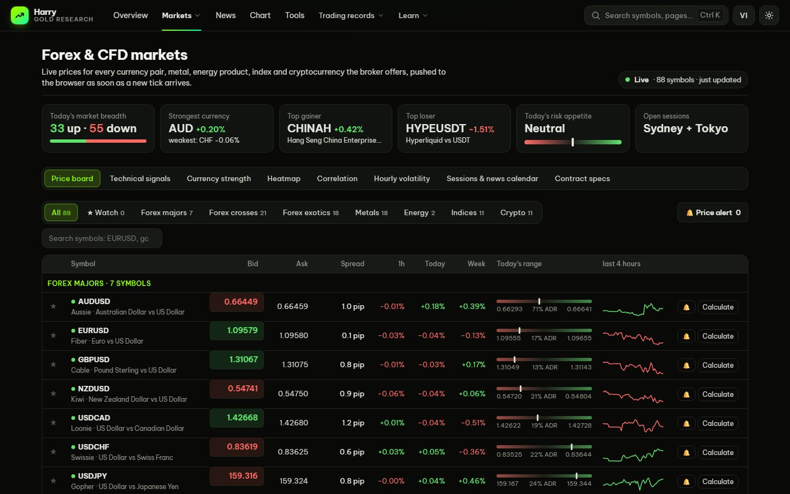
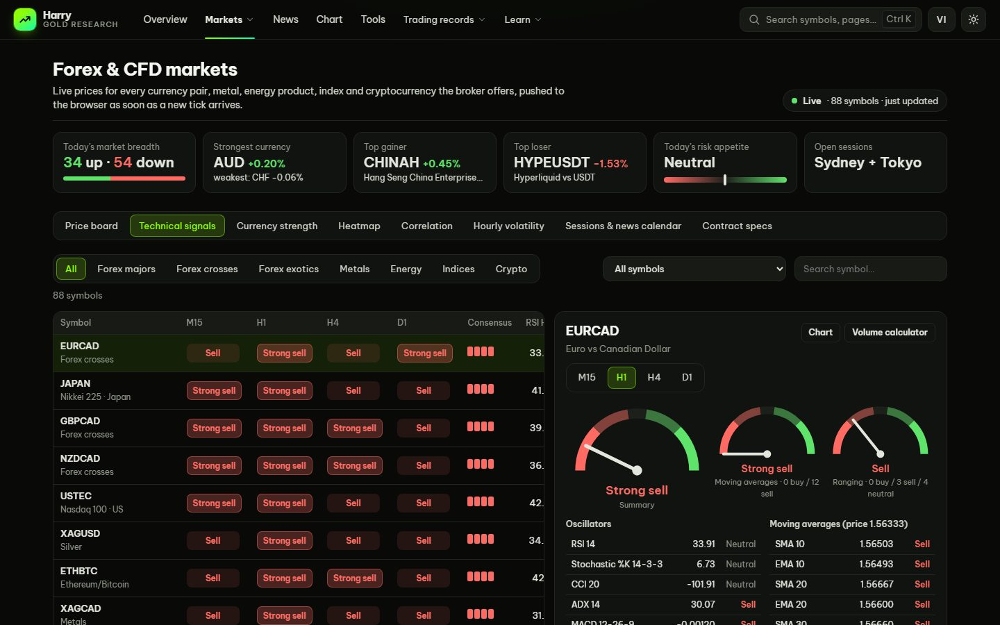
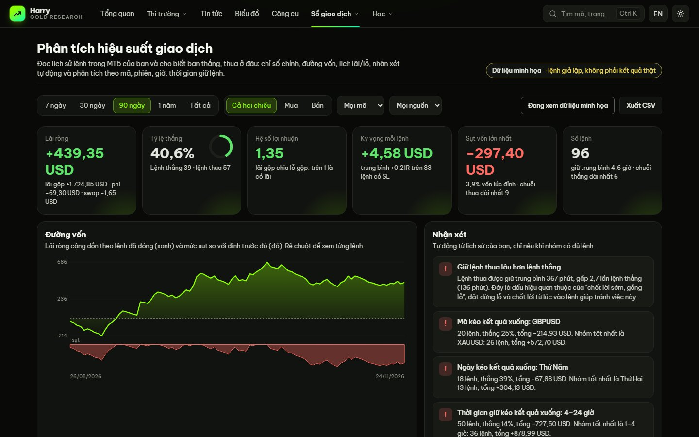

# Harry · Gold Research — Trading Dashboard · Forex & CFD

**Tiếng Việt** · [English](#english)

Bảng điều khiển giao dịch Forex và CFD chạy ngay trên máy tính của bạn, lấy **giá trực tiếp từ MetaTrader 5** của chính bạn, song ngữ Việt / Anh.
Webapp **chỉ đọc**: không đặt lệnh, không sửa gì trong MT5, không gửi dữ liệu của bạn đi đâu.

**▶ Xem demo trực tuyến (không cần cài):** [Kế hoạch vốn và lệnh](https://harry-kien.github.io/tradingdashboard/ke-hoach.html) · [Kỷ luật giao dịch](https://harry-kien.github.io/tradingdashboard/ky-luat.html) · [Bảng giá & tín hiệu](https://harry-kien.github.io/tradingdashboard/thi-truong.html) · [Phân tích hiệu suất](https://harry-kien.github.io/tradingdashboard/) · English: [Markets](https://harry-kien.github.io/tradingdashboard/en/thi-truong.html), [Performance](https://harry-kien.github.io/tradingdashboard/en/)

## Tính năng

| Trang | Có gì |
|---|---|
| **Thị trường** | Bảng giá theo từng tick của mọi mã trong MT5 (Forex chính/chéo/ngoại lai, kim loại, năng lượng, chỉ số, crypto): Bid/Ask, spread, thay đổi 1 giờ/ngày/tuần, biên độ ngày và % ADR, đường giá 4 giờ, danh sách theo dõi, **cảnh báo giá**. **Tín hiệu kỹ thuật** 19 chỉ báo × 4 khung (như Technical Ratings của TradingView) kèm bộ lọc mã. Sức mạnh 8 đồng tiền, bản đồ nhiệt, ma trận tương quan, biến động theo giờ, bốn phiên lớn, lịch tin kinh tế 9 đồng tiền, thông số hợp đồng (pip, ký quỹ, đòn bẩy, swap). |
| **Tin tức & tâm lý** | Tin nhanh từ InvestingLive (ForexLive), CNBC, Fed, ECB, BoE có gắn nhãn đồng tiền; vị thế quỹ đầu cơ theo báo cáo COT của CFTC (thứ hạng 3 năm); chỉ số Sợ hãi & Tham lam; khẩu vị rủi ro và đồng thuận kỹ thuật toàn thị trường. |
| **Biểu đồ** | Nến M5–D1 theo từng tick (TradingView Lightweight Charts), EMA, Bollinger, RSI, hỗ trợ/kháng cự, FVG, khối lệnh, công cụ vẽ, phân tích điểm vào theo các phương pháp tùy chọn kèm số đo lại trên dữ liệu của chính mã. |
| **Công cụ** | Khối lượng theo % rủi ro, giá trị pip, lãi/lỗ và ký quỹ (MT5 tính lại cho chính xác), mức gọi ký quỹ, pivot 4 kiểu, Fibonacci, R:R và kỳ vọng, xác suất chuỗi thua. |
| **Phân tích hiệu suất** ✨ | Đọc lịch sử lệnh đã đóng trong MT5 và cho biết **bạn thắng, thua ở đâu**: lãi ròng, tỷ lệ thắng, hệ số lợi nhuận, kỳ vọng mỗi lệnh (cả theo R), sụt vốn lớn nhất, chuỗi thắng/thua; đường vốn kèm vùng sụt vốn; lịch lãi/lỗ theo ngày; **nhận xét tự động** (giữ lệnh thua quá lâu, tăng khối lượng sau lệnh thua, lệnh không có SL, mã/phiên/giờ/thứ đang kéo kết quả xuống…); phân tích theo mã, chiều, phiên, thứ, giờ, thời gian giữ, nguồn (tay hay EA); bảng lệnh sắp xếp được, xuất CSV. **Ảnh chia sẻ** kết quả 1200×630 (mặc định chỉ hiện %, không lộ quy mô tài khoản), tải PNG hoặc sao chép thẳng vào bài đăng. Có dữ liệu minh họa để xem thử. |
| **Giám sát rủi ro trên mọi trang** 🚨 | Dải cảnh báo ngay dưới thanh điều hướng, tự kiểm tài khoản mỗi 30 giây: **chạm giới hạn lỗ ngày**, **lệnh đang mở không có dừng lỗ**, **tổng rủi ro vượt mức**, một lệnh rủi ro quá lớn, vừa vào lệnh ngay sau lệnh thua, sắp có tin mạnh khi đang giữ lệnh. Dùng cùng quy tắc bạn đặt; mỗi cảnh báo ẩn được tới hết ngày. |
| **Kế hoạch vốn và lệnh** 💰 | Nhập vốn (hoặc lấy vốn từ MT5), chọn mức rủi ro An toàn / Cân bằng / Mạnh: chia vốn thành **rủi ro mỗi lệnh, giới hạn lỗ ngày, tổng rủi ro được mở**, mô phỏng 2.000 chuỗi 100 lệnh để ra **khả năng sụt 20% và mất một nửa tài khoản**. Chọn mã, chiều, phong cách (M15/H1/H4): gợi ý **dừng lỗ theo đỉnh/đáy gần nhất và theo ATR**, chốt lời 1R/2R/3R và đỉnh/đáy đối diện, tính **khối lượng, ký quỹ và khoảng giá tới mức sàn đóng lệnh**. Báo đỏ khi vốn quá nhỏ cho dừng lỗ, khi sàn sẽ đóng lệnh trước dừng lỗ, khi kỳ vọng âm. Một nút chuyển sang Kiểm tra trước khi vào lệnh với số liệu điền sẵn. |
| **Kiểm tra trước khi vào lệnh** 🛡️ | Nhập lệnh dự định: tính **khối lượng đúng theo % rủi ro** và chấm từng quy tắc quản lý rủi ro bằng dữ liệu thật từ MT5 (dừng lỗ, lời/lỗ, dừng lỗ so với ATR, spread, **tin mạnh sắp ra**, **giới hạn lỗ ngày**, tổng rủi ro đang mở, vào gấp sau lệnh thua, các mã tương quan cùng chiều, ngược xu hướng khung lớn, và **lịch sử của chính bạn với kiểu lệnh này**: cùng mã, chiều, phiên trong 180 ngày đang thắng hay đang làm bạn lỗ) → **Đạt / Cân nhắc / Không nên**. Chặn những lỗi làm mất tiền hay gặp nhất; không đoán giá, không đặt lệnh. |
| **Kỷ luật giao dịch** 📋 | Chấm lại từng lệnh **đã đóng** trong MT5 (7/30/90 ngày, lọc theo đặt tay hoặc từng EA) theo cùng bộ quy tắc: không có dừng lỗ, **rủi ro vượt mức mỗi lệnh**, vào gấp hoặc tăng khối lượng sau lệnh thua, vẫn vào khi đã chạm giới hạn lỗ ngày, quá số lệnh mỗi ngày, vào sát tin mạnh. Tách **lãi lỗ của lệnh đúng quy tắc và lệnh phạm quy tắc**, điểm kỷ luật, rủi ro trung bình mỗi lệnh, chuỗi thua dài nhất, để thấy thói quen nào đang tốn tiền. |
| **Sổ giao dịch** | Nhật ký điểm vào chấm bằng giá thật; tài khoản MT5 (vốn, lệnh mở, lãi lỗ theo ngày, số tài khoản được che). |
| **Học** | CFD/Forex cơ bản, các loại lệnh, 16 phong cách giao dịch, bài chọn phong cách, quản lý rủi ro; giải thích từng chỉ báo. |

Tìm nhanh mã hoặc trang bằng **Ctrl+K**. Nền sáng/tối, giao diện điện thoại, nút **EN / VI** đổi ngôn ngữ.

| Tín hiệu kỹ thuật | Tin tức & tâm lý |
|---|---|
|  |  |

## Cài và chạy (Windows)

Chỉ cần **MetaTrader 5** đã đăng nhập tài khoản **demo** (sàn bất kỳ). Python không cần tự cài.

1. Tải mã về (nút **Code → Download ZIP**) và giải nén, hoặc `git clone`.
2. Mở MT5, rồi bấm đúp **`BAT_DAU.bat`**. Lần đầu nó tự cài Python (nếu máy chưa có, có hỏi trước, dùng winget có sẵn của Windows)
   và thư viện, tạo biểu tượng **Harry Gold Research** ngoài màn hình, rồi mở trang http://127.0.0.1:8765.
   Những lần sau chỉ cần bấm biểu tượng đó.

Chi tiết cấu hình và cách xử lý sự cố: [HUONG_DAN.md](HUONG_DAN.md).

## Dữ liệu và quyền riêng tư

- Giá, nến, thông số hợp đồng, lịch sử lệnh đã đóng: MT5 trên máy bạn (chỉ đọc; mặc định chỉ nhận tài khoản demo). Trang chỉ nghe ở 127.0.0.1, máy khác không vào được.
- Chỉ tải về từ Internet (không gửi gì đi): lịch kinh tế tuần (ForexFactory), RSS tin tức, báo cáo COT (cftc.gov), Fear & Greed (alternative.me).
  Tắt từng phần trong `cau-hinh.json`.

## Lưu ý

Mọi con số là số liệu mô tả thị trường và kết quả đo lại trên dữ liệu quá khứ, **không phải lời khuyên đầu tư**. Các tín hiệu và phương pháp
chưa được chứng minh là có lãi. CFD và Forex dùng đòn bẩy, rủi ro mất vốn cao.

Mã nguồn mở của bên thứ ba: TradingView Lightweight Charts™ (Apache-2.0), phông Be Vietnam Pro (SIL OFL 1.1). Xem [tinh/NGUON.md](tinh/NGUON.md).

---

## English

A Forex & CFD trading dashboard that runs on your own computer, streaming **live prices from your MetaTrader 5**, in Vietnamese and English
(switch with the **EN / VI** button). It is **read-only**: it never places orders, never changes anything in MT5 and never sends your data anywhere.

**Features:** tick-by-tick price board for every MT5 symbol with price alerts; technical ratings (19 indicators × 4 timeframes) with a screener;
currency strength, heatmap, correlation matrix, hourly volatility, trading sessions and a 9-currency economic calendar; contract specs (pip value,
margin, leverage, swap); news with currency tags; COT speculative positioning; crypto Fear & Greed; risk appetite; a tick-by-tick chart with
indicators and drawing tools; position-size, P/L, margin, pivot, Fibonacci and R:R calculators; an entry journal; trading lessons. Ctrl+K quick search.

**New: Trading performance analytics** (`/hieu-suat`). Reads your closed-trade history from MT5 and shows where you win and lose: net profit,
win rate, profit factor, expectancy (also in R), max drawdown and streaks. You also get an equity curve with drawdown, a daily P/L calendar
and automatic insights (holding losers too long, sizing up after a loss, trades without a stop loss, symbols/sessions/hours dragging results down).
Breakdowns cover symbol, direction, session, weekday, hour, holding time and source (manual vs EA). The trade table can be sorted and exported
to CSV. A **share image** (1200×630, percentages only by default so your account size stays private) can be downloaded or copied
straight into a post. A sample-data mode lets you preview the page.

**New: Risk monitor on every page.** A strip under the navigation bar checks your account every 30 seconds and warns when you hit the daily loss limit, hold a trade without a stop loss, exceed total open risk, hold an oversized trade, re-enter right after a loss, or hold trades into imminent high-impact news. It uses your own rules; each alert can be hidden for the rest of the day.

**New: Money and trade plan** (`/ke-hoach`). Enter your capital (or use MT5 equity) and a risk level: it splits it into risk per trade, a daily loss limit and total open risk, and simulates 2,000 runs of 100 trades to show the chance of a 20% drawdown or of losing half the account. Pick a symbol, direction and style (M15/H1/H4): it suggests a stop loss from the nearest swing high/low and from ATR, take profits at 1R/2R/3R and the opposite swing, and works out the size, margin and the adverse move to broker stop-out, with red flags when the capital is too small for the stop, when stop-out comes before the stop, or when the expectancy is negative. Try it in the live demo.

**New: Pre-trade check** (`/kiem-lenh`). Enter a planned trade: it sizes the position by % risk and checks each risk rule with your real MT5 data (stop loss, reward/risk, stop vs ATR, spread, upcoming high-impact news, daily loss limit, total open risk, revenge trading after a loss, correlated same-direction positions, trading against strong higher-timeframe signals, and **your own history with this kind of trade**: whether the same symbol, direction and session over the last 180 days has been winning or losing for you) → Pass / Caution / Avoid. It does not predict prices and never places orders.

**New: Trading discipline** (`/ky-luat`). Re-checks every closed MT5 trade (7/30/90 days, by manual or EA source) against the same rules: no stop loss, risk above the per-trade limit, quick re-entry or bigger size after a loss, trading after the daily loss limit, too many trades per day, entering near high-impact news. It splits the profit and loss of rule-following and rule-breaking trades and shows a discipline score, average risk per trade and the longest losing streak, so you can see which habits cost money.

**▶ Live demo (no install):** [Money and trade plan](https://harry-kien.github.io/tradingdashboard/en/ke-hoach.html) · [Trading discipline](https://harry-kien.github.io/tradingdashboard/en/ky-luat.html) · [Markets & signals](https://harry-kien.github.io/tradingdashboard/en/thi-truong.html) · [Performance analytics](https://harry-kien.github.io/tradingdashboard/en/)

**Install (Windows):** only MetaTrader 5 logged in to a **demo** account is needed. Open MT5 and double-click `BAT_DAU.bat`: on first run it
installs Python if missing (asks first, via the built-in winget) and the libraries, creates a **Harry Gold Research** desktop shortcut and opens
http://127.0.0.1:8765. Configuration lives in `cau-hinh.json` (created from `cau-hinh.mau.json`);
see [HUONG_DAN.md](HUONG_DAN.md) (Vietnamese) for details.

**Data:** prices from your local MT5 (read-only, demo accounts only by default; the server listens on 127.0.0.1 only). Download-only internet
sources: ForexFactory weekly calendar, news RSS, CFTC COT reports, alternative.me Fear & Greed — each can be turned off in the config.

**Disclaimer:** figures describe the market and re-measurements on past data; they are **not investment advice**. No signal or method here has
been proven profitable. CFDs and Forex are leveraged and carry a high risk of losing money.
