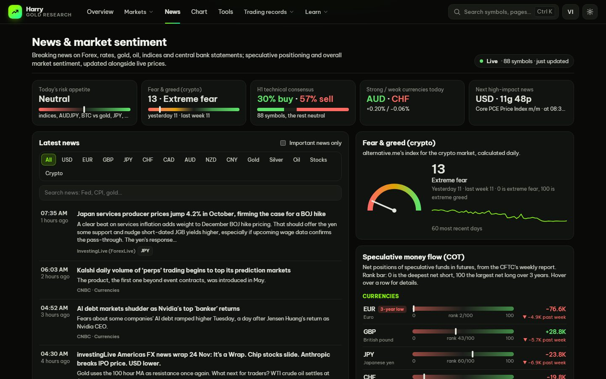

# Trading Dashboard · Forex & CFD

**Tiếng Việt** · [English](#english)

Bảng điều khiển giao dịch Forex và CFD chạy ngay trên máy tính của bạn, lấy **giá trực tiếp từ MetaTrader 5** của chính bạn, song ngữ Việt / Anh.
Webapp **chỉ đọc**: không đặt lệnh, không sửa gì trong MT5, không gửi dữ liệu của bạn đi đâu.

## Tính năng

| Trang | Có gì |
|---|---|
| **Thị trường** | Bảng giá theo từng tick của mọi mã trong MT5 (Forex chính/chéo/ngoại lai, kim loại, năng lượng, chỉ số, crypto): Bid/Ask, spread, thay đổi 1 giờ/ngày/tuần, biên độ ngày và % ADR, đường giá 4 giờ, danh sách theo dõi, **cảnh báo giá**. **Tín hiệu kỹ thuật** 19 chỉ báo × 4 khung (như Technical Ratings của TradingView) kèm bộ lọc mã. Sức mạnh 8 đồng tiền, bản đồ nhiệt, ma trận tương quan, biến động theo giờ, bốn phiên lớn, lịch tin kinh tế 9 đồng tiền, thông số hợp đồng (pip, ký quỹ, đòn bẩy, swap). |
| **Tin tức & tâm lý** | Tin nhanh từ InvestingLive (ForexLive), CNBC, Fed, ECB, BoE có gắn nhãn đồng tiền; vị thế quỹ đầu cơ theo báo cáo COT của CFTC (thứ hạng 3 năm); chỉ số Sợ hãi & Tham lam; khẩu vị rủi ro và đồng thuận kỹ thuật toàn thị trường. |
| **Biểu đồ** | Nến M5–D1 theo từng tick (TradingView Lightweight Charts), EMA, Bollinger, RSI, hỗ trợ/kháng cự, FVG, khối lệnh, công cụ vẽ, phân tích điểm vào theo các phương pháp tùy chọn kèm số đo lại trên dữ liệu của chính mã. |
| **Công cụ** | Khối lượng theo % rủi ro, giá trị pip, lãi/lỗ và ký quỹ (MT5 tính lại cho chính xác), mức gọi ký quỹ, pivot 4 kiểu, Fibonacci, R:R và kỳ vọng, xác suất chuỗi thua. |
| **Sổ giao dịch** | Nhật ký điểm vào chấm bằng giá thật; tài khoản MT5 (vốn, lệnh mở, lãi lỗ theo ngày, số tài khoản được che). |
| **Học** | CFD/Forex cơ bản, các loại lệnh, 16 phong cách giao dịch, bài chọn phong cách, quản lý rủi ro; giải thích từng chỉ báo. |

Tìm nhanh mã hoặc trang bằng **Ctrl+K**. Nền sáng/tối, giao diện điện thoại, nút **EN / VI** đổi ngôn ngữ.

| Tín hiệu kỹ thuật | Tin tức & tâm lý |
|---|---|
|  |  |

## Cài và chạy (Windows)

Cần **Python 3.11+** (tick "Add python.exe to PATH" khi cài) và **MetaTrader 5** đã đăng nhập tài khoản **demo** (sàn bất kỳ).

1. Tải mã về (nút **Code → Download ZIP**) và giải nén, hoặc `git clone`.
2. Bấm đúp **`CAI_DAT.bat`**: cài thư viện và tạo `cau-hinh.json` từ `cau-hinh.mau.json`.
3. Mở MT5, rồi bấm đúp **`CHAY_WEBAPP.bat`**. Trang mở ở http://127.0.0.1:8765.

Chi tiết cấu hình và cách xử lý sự cố: [HUONG_DAN.md](HUONG_DAN.md).

## Dữ liệu và quyền riêng tư

- Giá, nến, thông số hợp đồng: MT5 trên máy bạn (chỉ đọc; mặc định chỉ nhận tài khoản demo). Trang chỉ nghe ở 127.0.0.1, máy khác không vào được.
- Chỉ tải về từ Internet (không gửi gì đi): lịch kinh tế tuần (ForexFactory), RSS tin tức, báo cáo COT (cftc.gov), Fear & Greed (alternative.me).
  Tắt từng phần trong `cau-hinh.json`.

## Lưu ý

Mọi con số là số liệu mô tả thị trường và kết quả đo lại trên dữ liệu quá khứ, **không phải lời khuyên đầu tư**. Các tín hiệu và phương pháp
chưa được chứng minh là có lãi. CFD và Forex dùng đòn bẩy, rủi ro mất vốn cao.

Mã nguồn mở của bên thứ ba: TradingView Lightweight Charts™ (Apache-2.0), phông Be Vietnam Pro (SIL OFL 1.1). Xem [tinh/NGUON.md](tinh/NGUON.md).

---

## English

A Forex & CFD trading dashboard that runs on your own computer, streaming **live prices from your MetaTrader 5**, in Vietnamese and English
(switch with the **EN / VI** button). It is **read-only**: it never places orders, never changes anything in MT5 and never sends your data anywhere.

**Features:** tick-by-tick price board for every MT5 symbol with price alerts; technical ratings (19 indicators × 4 timeframes) with a screener;
currency strength, heatmap, correlation matrix, hourly volatility, trading sessions and a 9-currency economic calendar; contract specs (pip value,
margin, leverage, swap); news with currency tags; COT speculative positioning; crypto Fear & Greed; risk appetite; a tick-by-tick chart with
indicators and drawing tools; position-size, P/L, margin, pivot, Fibonacci and R:R calculators; an entry journal; trading lessons. Ctrl+K quick search.

**Install (Windows):** Python 3.11+ and MetaTrader 5 logged in to a **demo** account. Run `CAI_DAT.bat` once, open MT5, then run
`CHAY_WEBAPP.bat` and browse to http://127.0.0.1:8765. Configuration lives in `cau-hinh.json` (created from `cau-hinh.mau.json`);
see [HUONG_DAN.md](HUONG_DAN.md) (Vietnamese) for details.

**Data:** prices from your local MT5 (read-only, demo accounts only by default; the server listens on 127.0.0.1 only). Download-only internet
sources: ForexFactory weekly calendar, news RSS, CFTC COT reports, alternative.me Fear & Greed — each can be turned off in the config.

**Disclaimer:** figures describe the market and re-measurements on past data; they are **not investment advice**. No signal or method here has
been proven profitable. CFDs and Forex are leveraged and carry a high risk of losing money.
